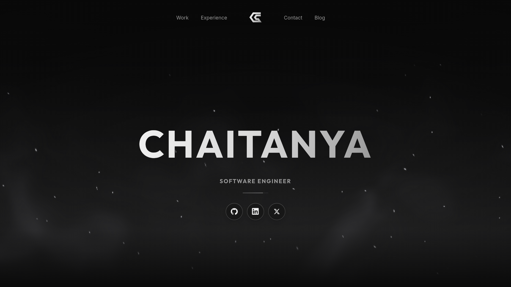

# Chaitanya Sanapala — Portfolio

The personal site of Chaitanya Sanapala, a software engineer in Bangalore working across backend development, SaaS quality engineering and AI systems. It covers selected work, experience, writing and contact details.



## Features

- **Hero:** a 1.6-second ignition intro, a WebGL spark-and-smoke background that reacts to the cursor, a scrolling role line and a logo that draws itself before the navigation fades in.
- **Five colour themes:** Graphite (default), Blue, Green, Rust and Paper. Click the header logo while the hero is in view to cycle them.
- **Case studies:** one MDX file per project, with highlights and covers that morph out of the home page through view transitions.
- **Blog:** MDX posts with an RSS feed, build-time syntax highlighting, a reading progress line and transitions between the list and each post.
- **Page transitions:** titles, dates and the logo morph between pages with cross-document view transitions in Chrome and Safari. Firefox, which lacks them, gets a scripted version (`src/scripts/page-morph.ts`).
- **⌘K menu:** search and jump to projects, roles, posts and contact links.
- **Production details:** responsive from small phones to large displays, accessible motion controls, reduced-motion support, SEO metadata, JSON-LD, a sitemap and security headers.

No UI framework ships to the browser. Everything is Astro components, CSS and a little TypeScript.

## Tech stack

[Astro 7](https://astro.build) · TypeScript (strict) · [Tailwind CSS 4](https://tailwindcss.com) · MDX · Zod · [Motion](https://motion.dev), used at build time only · Vercel

## Getting started

You need Node.js 24 and pnpm (`package.json` records the exact version).

```sh
pnpm install
pnpm dev         # http://localhost:4321
pnpm check       # Astro and TypeScript diagnostics
pnpm build       # production output for Vercel
pnpm preview     # serve the production build
```

To run the dev server in the background, use `pnpm dev --background`, and manage it with `pnpm astro dev status`, `logs` and `stop`.

## Project structure

```text
src/
  pages/              index, work/[slug], blog/index, blog/[...id], 404, rss.xml, robots.txt
  content/work/       case studies (MDX); screenshots live in src/assets/work/
  content/blog/       blog posts (MDX)
  content.config.ts   Zod schemas for both collections
  data/resume.ts      profile, experience and social links
  components/         header, footer, logo, hero intro, role scroller, ⌘K menu
  layouts/            shared document metadata
  lib/themes.ts       theme list (the first entry is the default)
  lib/blaze/          WebGL hero background
  scripts/            client-side interactions and theme switcher
  styles/global.css   Tailwind import, theme tokens and view transitions
public/               résumé PDF, icons, Open Graph image, fonts
scripts/              icon generator and theme checks
```

`@/` resolves to `src/`.

## Content

**Case studies.** Add an MDX file to `src/content/work/`. Front matter can set up to three `highlights` (value and label) for the at-a-glance row, plus an optional `badge` such as "Proof of concept".

**Blog posts.** Add an MDX file to `src/content/blog/` with `title`, `description`, `publishedAt` and optional `tags`.
- `draft: true` previews a post in development only.
- Blog links in the header, footer and ⌘K menu appear once at least one post is published.
- Posts republished from elsewhere, such as Medium, set `canonicalUrl` to the original article. That URL becomes the page's canonical link, the post stays out of the sitemap, and the page shows an "Originally on Medium" link.

## Themes

The theme you choose is saved in `localStorage` and restored before the first paint, so pages never flash the wrong colours. Paper is the light theme: it keeps the CSS gradient and pauses the WebGL effect, which looks muddy on a light background.

To add a theme:
1. Add its ID, name, background and colour scheme to `src/lib/themes.ts`.
2. Add a matching `:root[data-theme="…"]` block to `src/styles/global.css`, including the normalised `--spark-rgb` and `--smoke-rgb` values.
3. Run `node scripts/check-theme-contrast.mjs` to check that text and accents reach a 4.5:1 contrast ratio.

To test responsiveness and the main interactions in Chromium, Firefox and WebKit, run the production preview, then `PLAYWRIGHT_MODULE=/path/to/playwright-core/index.mjs node scripts/verify-browsers.mjs firefox`. Playwright is supplied externally rather than added as a dependency.

The favicon, touch and app icons use the Graphite colours. If the logo or default palette changes, run `node scripts/generate-icons.mjs` to regenerate them.

## Performance

The hero background loads after the page is idle and draws one WebGL pass of at most about 420,000 pixels:
- It runs at 30 FPS on desktop and 24 FPS on small screens, and rises to 60 FPS only while the cursor is shaping the sparks.
- It pauses when the tab is hidden, when the hero is off-screen and when the visitor pauses motion.
- On slow devices it steps down its resolution and finally settles on a still frame.
- Software renderers and reduced-motion visitors get the static CSS glow instead.

Only Outfit Bold is preloaded; all fonts are self-hosted.

## Deployment

The site is a static Astro build deployed on Vercel. Import the repository with the Astro preset; the build command is `pnpm build` and the Node.js version is 24.

Canonical URLs, Open Graph tags, `robots.txt` and the sitemap use Vercel's production domain (`VERCEL_PROJECT_PRODUCTION_URL`). For a custom domain, set `SITE_URL`, for example `https://example.com`. `vercel.json` adds security headers and long-lived caching for the fonts.

## Credits

- Fonts: [Outfit](https://fonts.google.com/specimen/Outfit), [Inter](https://rsms.me/inter/) and [JetBrains Mono](https://www.jetbrains.com/lp/mono/), all under the SIL Open Font License.
- The hero background is adapted from [Canvas UI Blaze](https://canvasui.dev/docs/components/blaze).

Their licences are kept in [`licenses/`](licenses/).

## License

The source code is released under the [MIT License](LICENSE). You're welcome to learn from it or reuse it for your own site.

The personal content is not covered by that licence. It remains © Chaitanya Sanapala, all rights reserved:
- the case studies and blog posts in `src/content/`;
- the profile and experience text in `src/data/resume.ts`;
- the résumé PDF;
- the project screenshots in `src/assets/work/`;
- the C/S logo design and its renders, including the favicon, app icons, `public/og.png` and `docs/hero.png`.

If you fork the site, replace these with your own. The third-party fonts and the adapted background keep their own licences, listed above.
